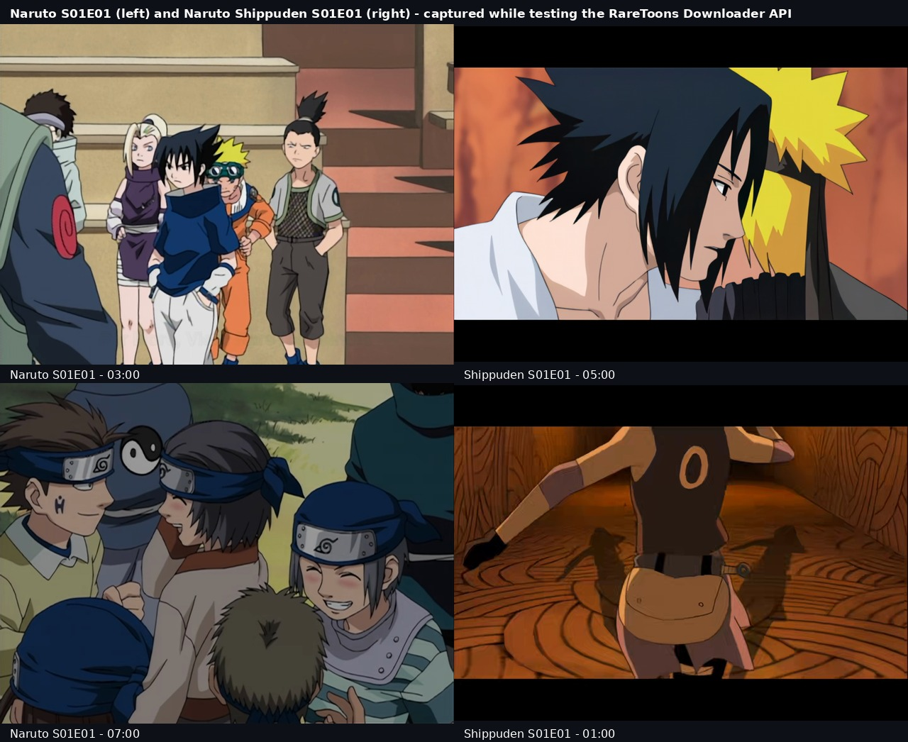

> **Disclaimer:** This repository hosts the Rare Toons India downloader API **source code** and a
> single **preview image** only. It does not host, mirror or redistribute any episode file, and it
> does not claim any ownership of *Naruto* or its characters. Ownership, usage terms and removal
> requests are set out in [DISCLAIMER.md](DISCLAIMER.md). Please read it before using or sharing
> anything from this repository.

# RareToons Downloader API

A JSON API for the [rareanimes.foo](https://www.rareanimes.foo/) catalogue (Rare Toons India).
It exposes every series, episode, quality variant and download link, and turns host pages
(HubCloud, Pixeldrain, Argon, MEGA, GoFile) into direct file URLs.

Two ways to run it, one payload format:

| Deployment | Use it when | Needs |
| --- | --- | --- |
| **WordPress plugin** | You have server access to rareanimes.foo | WordPress 6.0+, PHP 7.4+ |
| **Standalone PHP** | You want the API on a separate host or domain | Any LAMP host with PHP 7.4+ |

Both share the same `core/`, so the JSON is identical whichever you pick.

---

## Endpoints

Base URL: `https://www.rareanimes.foo/wp-json/rai/v1` (plugin) or whatever host you point the
standalone service at.

| Method | Path | What it returns |
| --- | --- | --- |
| GET | `/series` | Paginated list. `page`, `per_page`, `search`, `category`, `orderby`, `order` |
| GET | `/series/{slug}` | One series with every episode and link |
| GET | `/series/{slug}/episodes` | Episodes only, without the series wrapper |
| GET | `/series/{slug}/episodes/{number}` | One episode |
| GET | `/series/{slug}/episodes/{number}/links` | One episode with every link resolved to a direct URL. Add `?refresh=1` to bypass the cache |
| GET | `/resolve?url=` | Resolve any single host URL. Add `?refresh=1` to bypass the cache |
| GET | `/search?q=` | Search the catalogue |
| GET | `/categories` | Every category with its id, name and slug |
| GET | `/stats` | Series count, category count and the supported hosts |
| GET | `/health` | Liveness check (never requires a key) |

Errors come back as `{"error": {"code": "...", "message": "..."}}` with a matching HTTP status:
400 for a bad request, 401 for a missing key, 404 for an unknown series or episode.

### Examples

```bash
# Browse
curl "https://www.rareanimes.foo/wp-json/rai/v1/series?per_page=5&orderby=date"

# One series
curl "https://www.rareanimes.foo/wp-json/rai/v1/series/naruto-season-1-hindi-dubbed-episodes-download-hd"

# Episode 1 with real download URLs
curl "https://www.rareanimes.foo/wp-json/rai/v1/series/naruto-season-1-hindi-dubbed-episodes-download-hd/episodes/1/links"

# Resolve one link
curl "https://www.rareanimes.foo/wp-json/rai/v1/resolve?url=https://pixeldrain.com/u/7AgY7b6q"

# Search
curl "https://www.rareanimes.foo/wp-json/rai/v1/search?q=naruto"
```

---

## Hosts the resolver understands

| Host | What the API gives you | Notes |
| --- | --- | --- |
| **HubCloud** (`hubcloud.mov`, `.ist`, `.pw`, `yournewdomain.com`) | Signed Cloudflare R2 URL, real filename, exact size, expiry time | The signature lasts about 8 hours, so the resolver cache is kept below that |
| **Pixeldrain** | Direct download URL, filename, size, SHA-256 | Fastest and most reliable of the lot |
| **Argon** (`argon.razorshell.space`) | Direct download URL per quality, plus the full quality list | The quality list is in `resolution.meta.qualities` |
| **MEGA** (`mega.nz`) | Direct URL, size, file key and the encrypted attributes | MEGA stores the payload encrypted, so the bytes need a MEGA aware client. `requires_client` is `true` |
| **GoFile** (`gofile.io`) | Every file in the folder with its direct link, size and MD5 | Season packs are listed too, so one episode can be pulled out of a multi gigabyte ZIP |
| **ZipCloud** (`animetoonhindi.com`) | The original link only | The host sits behind a Cloudflare challenge, so it cannot be resolved server side |
| **Direct files** | Size, filename, MIME type | Anything ending in `.mkv`, `.mp4`, `.zip` and friends |

A host that cannot be resolved never breaks the response. The link is still returned, with
`resolved: false` and a `reason` explaining why.

---

## Installing the WordPress plugin

1. Upload `dist/rareanimes-downloader-api.zip` in **Plugins → Add New → Upload Plugin**,
   or copy the `plugin/rareanimes-downloader-api` folder into `wp-content/plugins/`.
2. Activate it.
3. Open **Settings → Downloader API**. Copy the API key, decide whether requests must include it,
   and set the allowed CORS origin.

Nothing else to configure — the plugin reads the posts from the database, so it never scrapes your
own site and it stays fast. If you cannot use the admin installer, drop the folder into
`wp-content/mu-plugins/` instead; WordPress loads it automatically.

### Using the key

```bash
curl -H "X-RAI-Key: rai_xxxxxxxx" "https://www.rareanimes.foo/wp-json/rai/v1/series"
```

`?api_key=` works too, for clients that cannot set headers.

## Installing the standalone service

```bash
git clone <this-repo> rai-api && cd rai-api
cp standalone/config.example.php standalone/config.php
$EDITOR standalone/config.php
```

Point a virtual host at `standalone/`. For Apache, add `standalone/.htaccess`; for nginx:

```nginx
location / {
    try_files $uri /index.php$is_args$args;
}
```

Test it:

```bash
php -S 127.0.0.1:8000 -t standalone
curl "http://127.0.0.1:8000/health"
```

The standalone service reads the catalogue through the public WordPress REST API, so it needs no
database access and can live on a completely different host.

---

## Authentication

Off by default so you can test straight away. Switch it on in the plugin settings or with
`'api_key' => '…'` in the standalone config. When a key is set, every endpoint except `/health`
needs it.

## Caching

| What | Default | Where |
| --- | --- | --- |
| Parsed series | 1 hour | Plugin: transients. Standalone: files in `cache/` |
| Resolved links | 30 minutes | Same |
| Category list | 6 hours | Same |

Resolved links are cached because a HubCloud signature is only valid for about eight hours; cache
longer than that and you hand out dead URLs.

---

## Episode verification

Two episodes were downloaded end to end through this API and checked with `ffprobe`:

| Episode | File | Duration | Format | Size |
|---------|------|----------|--------|------|
| Naruto Season 1 Episode 1 (original series, Hindi dub) | `Naruto S01E01 [RareToonsIndia].mkv` | 23:25 | Matroska / HEVC 1440x1080 + Opus | 197,280,150 B |
| Naruto Shippuden Season 1 Episode 1 (Hindi dub) | `Naruto Shippuden S01E01 in Hindi.mkv` | 23:13 | Matroska / HEVC 1452x1072 + Opus | 199,711,919 B |

**The episode files themselves are not redistributed here.** Only the preview image below is
published.



See [`media/README.md`](media/README.md) for what the preview shows and
[`DISCLAIMER.md`](DISCLAIMER.md) for ownership and usage terms.

---

## Repository layout

```
core/                     shared PHP: parser, resolver, HTTP, cache
plugin/                   the WordPress plugin
standalone/               the standalone front controller
dist/                     the installable plugin zip
tools/verify.php          parse the live catalogue and report
tools/test-plugin.php     exercise the plugin without WordPress
tools/test-hosts.php      resolve one live link per host
tools/test-gofile.php     list a GoFile folder and the members of its archive
tools/extract-member.php  pull one episode out of a season pack
tools/build.php           copy the core into the plugin and build the zip
docs/openapi.yaml         OpenAPI 3.1 description
```

## Licence

GPL-2.0-or-later — see [`LICENSE`](LICENSE). The licence covers the **source code only**; it
grants no rights over the copyrighted material shown in the preview image.
